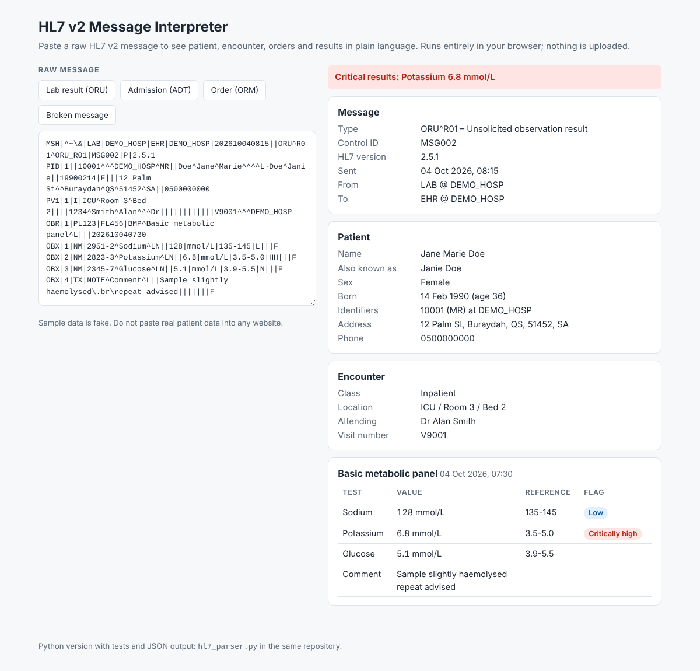

# HL7 v2 Message Parser & Interpreter

Turns a raw HL7 v2 message into structured, human-readable clinical information: patient
demographics, encounter details, lab orders and observations (with abnormal and critical flags),
allergies, diagnoses and next of kin.



Two ways to use it:

- **`index.html`** – a browser interpreter. Open the file, or host it free with GitHub Pages.
  Runs fully client-side, nothing is uploaded.
- **`hl7_parser.py`** – the same logic as a Python command-line tool and library, with tests.

> Learning project. Sample data is fake. Do not paste real patient data into any website or tool
> that has not been approved for it.

## What it understands

| Segment | Used for |
|---|---|
| MSH, EVN | message type and description, control ID, version, sender and receiver, timestamps |
| PID, NK1 | identifiers (repeating), names and aliases, birth date and age, sex, address, phone, next of kin |
| PV1 | patient class, location, attending doctor, visit number, admit and discharge time |
| AL1, DG1 | allergies with severity, diagnoses |
| ORC, OBR, OBX | orders, results, units, reference ranges, abnormal flags (L, H, LL, HH, A...), result status |

It also handles repeating fields (`~`), components (`^`), HL7 escape sequences (`\F\`, `\.br\`...),
non-standard delimiters read from MSH-2, and partial-precision timestamps.

## Data-quality warnings

It does not just parse, it tells you what is wrong: empty message control ID, impossible dates
(31 February), non-standard sex or patient-class codes, missing patient identifier,
OBX without a preceding OBR, and non-numeric values in numeric (NM) results.

## Command line

```
python hl7_parser.py sample_oru.hl7            # readable report
python hl7_parser.py sample_oru.hl7 --json     # structured JSON
python hl7_parser.py sample_oru.hl7 --fields   # every field with its HL7 name
python -m unittest test_hl7_parser -v          # tests
```

Example output:

```
ORDER     Basic metabolic panel  [Final]
   - Sodium: 128 mmol/L (ref 135-145)  <-- LOW
   - Potassium: 6.8 mmol/L (ref 3.5-5.0)  <-- CRITICALLY HIGH
!! CRITICAL RESULTS: Potassium 6.8 mmol/L
```

## Files

`hl7_parser.py` · `index.html` · `test_hl7_parser.py` · `sample_adt.hl7` · `sample_oru.hl7` ·
`sample_orm.hl7` · `sample_bad.hl7`

## Limits

Covers the common ADT, ORM and ORU segments only. Code tables are shortened to the values used.
It reads messages; it does not validate against a full HL7 conformance profile.
